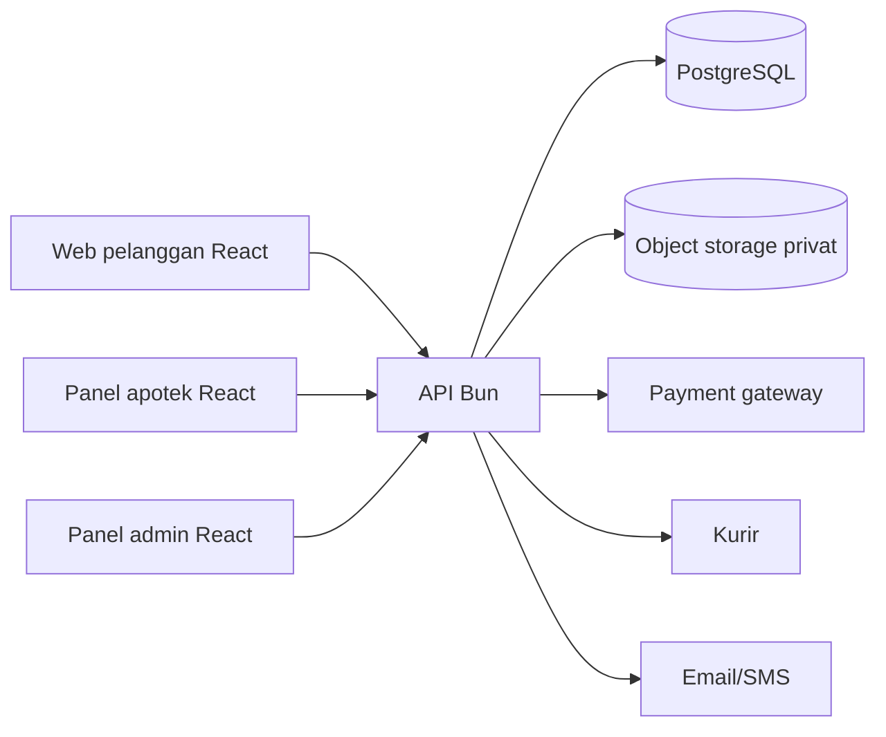

# Technical Requirements Document — FarmaGO MVP

**Versi:** 0.4 · **Status:** draf teknis ditinjau  
**Terkait:** [PRD](01-PRD.md) · [Database Design](05-DBD-Database-Design.md) · [Backend Schema](06-BSD-Backend-Schema.md)

## 1. Teknologi dan batasan

| Lapisan | Pilihan |
|---|---|
| Frontend | React JS, JavaScript, Vite; web responsif untuk pelanggan dan panel internal. |
| Backend | Bun sebagai runtime dan package manager; API HTTP modular. Hono diusulkan sebagai framework dan dapat diganti setelah keputusan tim. |
| Database | PostgreSQL; penyimpanan relasional sebagai sumber kebenaran transaksi. |
| File | Object storage privat kompatibel S3 untuk dokumen resep. |
| Integrasi | Payment gateway, penyedia pengiriman, dan email/SMS/push sesuai mitra yang dipilih. |
| Deployment | Container untuk frontend/backend, database terkelola, object storage, dan pemantauan. |

Gunakan versi stabil yang disetujui tim, lockfile, dan pembaruan dependensi terkontrol. Ini adalah pilihan rancangan, bukan keputusan vendor final.

## 2. Arsitektur



Satu backend modular cukup untuk pilot: auth, katalog, apotek dan inventori, pesanan, resep, pembayaran/refund, pemenuhan, notifikasi, dan audit. Pemrosesan notifikasi serta integrasi yang perlu percobaan ulang dapat menggunakan worker Bun dengan antrean/outbox yang tersimpan di database. Hindari menggandakan sumber kebenaran untuk transaksi.

## 3. Sesi, peran, dan otorisasi

- Pelanggan mempunyai akses ke data dan pesanan miliknya; staf apotek hanya ke apotek dan pesanan yang ditugaskan; admin hanya sesuai izin tugas.
- Gunakan cookie sesi `HttpOnly`, `Secure`, `SameSite` yang sesuai, proteksi CSRF untuk permintaan perubahan, dan masa sesi terbatas. Aktifkan MFA untuk pengguna internal sebelum pilot.
- Lakukan pemeriksaan otorisasi di server pada setiap operasi dan setiap akses file; menyembunyikan tombol di UI tidak cukup.
- Batas percobaan login dan unggah; kata sandi di-hash menggunakan algoritme adaptif. Data sensitif dan token tidak ditulis ke log.
- Verifikasi terikat pada nilai email/nomor yang benar-benar diverifikasi. Perubahan kontak mereset status verifikasi kontak tersebut; token untuk kontak lama tidak memverifikasi kontak baru. Registrasi publik hanya membuat peran pelanggan.

## 4. Konsistensi proses

### Reservasi dan stok

`available = on_hand - reserved`. Pembuatan pesanan dan seluruh reservasinya dilakukan dalam satu transaksi database, dengan penguncian baris stok dalam urutan konsisten serta pemeriksaan jumlah. Apabila salah satu item gagal, semuanya dibatalkan. Stok yang dilepas oleh job kedaluwarsa tidak boleh terlepas dua kali. Ketika apotek mengonfirmasi penyiapan, reservasi dikonsumsi dan `on_hand` dikurangi secara atomik.

Masa reservasi awal adalah 30 menit sebelum pembayaran, dapat dikonfigurasi. Jika pesanan sudah `paid`, reservasi tetap aktif dan tidak dilepas oleh job kedaluwarsa; reservasi berakhir melalui konsumsi saat `ready` atau pembatalan yang diotorisasi. Jika kedaluwarsa sebelum pembayaran terkonfirmasi, pesanan berakhir; pelanggan membuat pesanan baru setelah pengecekan harga dan stok. Semua tagihan memiliki batas waktu paling lambat sama dengan batas reservasi.

Pemroses pembayaran dan job kedaluwarsa mengunci pesanan dan memeriksa status dalam transaksi database. Pesanan hanya dapat menjadi `paid` jika pembayaran telah diverifikasi, waktu pembayaran menurut penyedia tidak melewati batas, status masih aktif, dan waktu server saat transisi masih sebelum batas reservasi; pemeriksaan waktu dilakukan walaupun job kedaluwarsa belum berjalan. Setelah pesanan menjadi `paid`, job tidak boleh melepas stok. Jika batas sudah lewat atau status sudah `expired`/`cancelled`, dana yang diterima dicatat sebagai `late` dan ditangani melalui rekonsiliasi/refund, tanpa mengaktifkan ulang pesanan. Ini juga berlaku bila pelanggan membayar sebelum batas tetapi konfirmasi diterima setelah batas; kasus tersebut memerlukan penanganan prioritas dan tidak dianggap kesalahan pelanggan. Ketidakpastian status pembayaran ditinjau operasional; jangan memberi refund ganda.

Pembatalan yang disetujui sebelum stok dikonsumsi melepas reservasi tepat sekali. Sesudah stok dikonsumsi saat `ready`, pembatalan tidak otomatis menambah stok: apotek memeriksa mutu dan kelayakan produk, lalu petugas membuat pergerakan stok terotorisasi sesuai SOP jika memang boleh dikembalikan ke stok. Selisih stok fisik yang lebih kecil dari stok terreservasi diblokir untuk penjualan baru dan dieskalasi; jangan memaksa angka stok menjadi negatif atau menghapus reservasi pesanan terbayar secara diam-diam.

### Resep dan pembayaran

- Berkas resep diunggah ke penyimpanan privat melalui endpoint terotorisasi; validasi ukuran dan tipe, pindai malware bila layanan tersedia, dan jangan tampilkan URL publik permanen.
- Persetujuan apoteker melekat pada pesanan dan item yang diperiksa; item tidak dapat diubah dalam pesanan yang sudah dibuat. Perubahan memerlukan pesanan baru dan pemeriksaan ulang bila relevan.
- Klarifikasi memiliki pesan dan lampiran privat yang dapat diakses pemilik pesanan dan apoteker yang ditugaskan. Pencatatan respons tidak otomatis menyetujui resep; apoteker harus membuat keputusan baru.
- Tagihan hanya dibuat setelah persyaratan resep terpenuhi dan reservasi valid. Setelah terbayar, apotek melaksanakan penyiapan sesuai prosedur.
- Saat membuat pesanan yang memerlukan resep, server memastikan apotek sedang membuka layanan pemeriksaan resep; jam layanan dan sisa reservasi ditampilkan kepada pelanggan. Sistem tidak menjanjikan waktu pemeriksaan sampai kapasitas pilot terbukti.
- Webhook payment gateway divalidasi sesuai spesifikasi penyedia. Simpan `provider_event_id` unik dan proses secara idempotent; status ditetapkan berdasarkan verifikasi transaksi penyedia, bukan input frontend.
- Outbox transaksi, antrean percobaan ulang terbatas, dan rekonsiliasi periodik menangani gangguan integrasi; panggilan ke penyedia tidak dilakukan dalam transaksi database yang panjang.

Pembuatan tagihan mempunyai status `creating` yang dihitung sebagai tagihan aktif. Sistem menyimpan permintaan dan kunci idempotensi sebelum memanggil penyedia, lalu memperbarui hasilnya. Bila panggilan time-out atau hasil tidak pasti, tagihan tetap `creating`; worker memeriksa penyedia menggunakan referensi/idempotensi yang sama sebelum retry atau menyatakan gagal. Tagihan lain tidak boleh dibuat selama hasil belum diketahui. Penyedia harus mendukung idempotensi atau pencarian berdasarkan referensi unik; jika tidak, integrasi tersebut memerlukan proses manual aman sebelum digunakan.

### Quote dan konfirmasi harga

Server menerbitkan quote ber-ID, milik pelanggan, dengan snapshot item, apotek, metode, alamat bila pengiriman, rincian biaya dan batas berlaku. Pengambilan di apotek tidak memerlukan alamat pengiriman. Saat `POST /orders`, server memeriksa quote belum kedaluwarsa dan menghitung ulang harga, ongkir, kelayakan, dan stok. Bila komponen harga atau ongkir berbeda, pesanan tidak dibuat: server mengembalikan `QUOTE_CHANGED` dan pelanggan harus meninjau quote baru. Perubahan isi alamat tersimpan, item atau metode juga memerlukan quote baru meskipun nilai total tetap sama. Bila hanya stok tidak tersedia, kembalikan `STOCK_UNAVAILABLE`. Komponen total disimpan sebagai snapshot pada pesanan yang berhasil.

### Pengiriman dan refund

Gunakan referensi unik untuk setiap permintaan pengiriman atau refund; simpan respons penyedia, lakukan retry aman, dan rekonsiliasi status tidak pasti. Detail resep tidak dikirim ke kurir. Total refund berstatus `requested`, `processing`, dan `succeeded` tidak melebihi dana yang benar-benar diterima, termasuk pembayaran `late` yang terverifikasi; penghitungan dilakukan dengan penguncian transaksi pembayaran.

## 5. Antarmuka sistem

API JSON menggunakan `/api/v1`, validasi input, otorisasi per sumber daya, dan respons kesalahan seragam. Contoh kontrak ada di [Backend Schema](06-BSD-Backend-Schema.md). Harga, ongkir, status, dan hak akses selalu dihitung/divalidasi server.

## 6. Keamanan dan privasi

- TLS, enkripsi database dan object storage, pengelolaan kunci dan secret di layanan secret terpisah.
- File resep dipisahkan dari aset publik; akses berumur pendek atau melalui proxy terotorisasi, dengan audit akses.
- Informasi minimum pada notifikasi, log, dan payload kurir. Pisahkan data pelanggan dari akses administratif yang tidak memerlukannya.
- Uji kontrol akses, unggah file, validasi webhook, rate limiting, dependensi, dan pemulihan data.
- Retensi, hak subjek data, lokasi penyimpanan, dan prosedur insiden ditentukan bersama tim hukum; tidak mengasumsikan persetujuan sebagai satu-satunya dasar pemrosesan.

## 7. Operasional

- Lingkungan development, staging, production terpisah; data uji sintetis, tanpa resep asli.
- Pantau error rate, latensi, antrean resep, reservasi kedaluwarsa, webhook gagal, refund, dan sinkronisasi kurir.
- Backup terenkripsi dan uji pemulihan berkala. Sasaran awal RPO 24 jam dan RTO 4 jam harus dibuktikan melalui uji.
- Target kinerja PRD divalidasi pada profil beban pilot yang disepakati. CI menjalankan lint, tes inti, pemeriksaan dependensi, dan build.

## 8. Struktur proyek usulan

```text
apps/
  web/                 # React JS: pelanggan dan panel berbasis peran
  api/                 # Bun: API dan worker
packages/
  shared/              # konstanta/validasi yang aman dipakai bersama
infra/                 # konfigurasi lingkungan dan deployment
docs/                  # dokumen proyek
```

## 9. Invariant dan pemulihan kegagalan

### Stok dan pemeriksaan fisik

`inventory.on_hand` adalah alokasi kanal daring, bukan seluruh stok apotek. Alokasi dipisahkan dari kasir toko; bila pemisahan tidak dapat dijamin, wajib ada integrasi reservasi POS sebelum pilot apotek tersebut. Setiap SKU memiliki satuan jual tetap. Apotek mencatat hasil pemeriksaan, lot/batch bila relevan, kedaluwarsa, dan petugas sebelum status `ready`; pemeriksaan akhir pesanan resep memerlukan apoteker. Ini belum merupakan inventori lot otomatis: pemilihan lot dan pemeriksaan fisik dilakukan apotek, dan catatannya disimpan untuk ketertelusuran.

### Pembatalan dan serah terima

Pengambilan oleh pelanggan atau kurir dan keputusan pembatalan mengunci pesanan yang sama. Pembatalan hanya boleh dari `awaiting_prescription`, `awaiting_payment`, `paid`, `processing`, atau `ready` dan belum ada serah terima. `in_delivery`, `completed`, `cancelled`, dan `expired` tidak dapat diubah menjadi `cancelled`. Sesudah serah terima, gunakan kasus bantuan/refund; status fisik pesanan dan riwayat tetap utuh. Refund tidak pernah menjadi pemicu otomatis untuk mengubah stok atau status pesanan.

### Pembayaran dan refund

Event penyedia dapat tiba tidak berurutan. Status pembayaran yang telah terverifikasi menerima dana (`succeeded`/`late`) tidak boleh diturunkan oleh event `pending`, `failed`, atau `expired`; kasus konflik direkonsiliasi ke penyedia. Verifikasi juga mata uang IDR, nominal tepat, referensi merchant dan pesanan. Selisih nominal atau pembayaran tambahan membuka kasus rekonsiliasi dan tidak menambah hak pemenuhan; pesanan hanya boleh dibayar untuk pemenuhan sekali.

Refund mempunyai `merchant_reference` unik. `requested` atau `processing` yang hasilnya belum pasti tetap menahan kuota refund. Time-out tidak boleh menjadi `failed`; periksa status penyedia dengan referensi sama. Hanya kegagalan definitif melepaskan kuota, dan retry permintaan eksternal selalu menggunakan referensi/idempotensi yang sama. Seluruh perubahan saldo refund dan pembayaran dikunci konsisten dalam transaksi singkat.

### Kurir, notifikasi dan bukti

Satu pesanan memiliki satu catatan pemenuhan logis; setiap percobaan booking kurir memiliki referensi sendiri. Hasil booking tidak pasti diperiksa terlebih dahulu sebelum mencoba booking baru. Status kurir dipetakan dan diverifikasi server; frontend tidak dapat menandai `delivered`. Pengambilan dicatat staf apotek menggunakan bukti/kode pengambilan sesuai SOP, bukan hanya klaim pelanggan. Kegagalan notifikasi tidak membatalkan transaksi; status pesanan tetap tersedia di aplikasi dan pengiriman notifikasi diulang lewat outbox.

### Resep, histori dan akses

Pengunggahan atau perubahan dokumen resep dan peninjauan hanya dapat dilakukan sebelum tagihan dibuat. Setelah tagihan ada, perubahan dokumen ditolak dan masuk jalur bantuan agar persetujuan tidak berubah saat pembayaran berjalan. Koreksi klinis yang diperlukan membekukan pemenuhan dan masuk pemeriksaan apoteker; keputusan refund/pembatalan mengikuti status fisik. Sistem menyimpan hash dokumen dan riwayat pemenuhan sebagai sinyal pemeriksaan duplikasi; hash yang berbeda tidak membuktikan resep berbeda. Penilaian validitas dan hak pemenuhan tetap oleh apoteker; repeat refill tidak termasuk MVP.

Pendaftaran publik hanya menghasilkan peran `customer`. Peran internal harus ditetapkan admin berwenang dan dicatat dalam audit; `admin`, `cs`, atau `pharmacy_staff` tidak otomatis mendapat hak baca berkas resep atau mengambil keputusan klinis.
