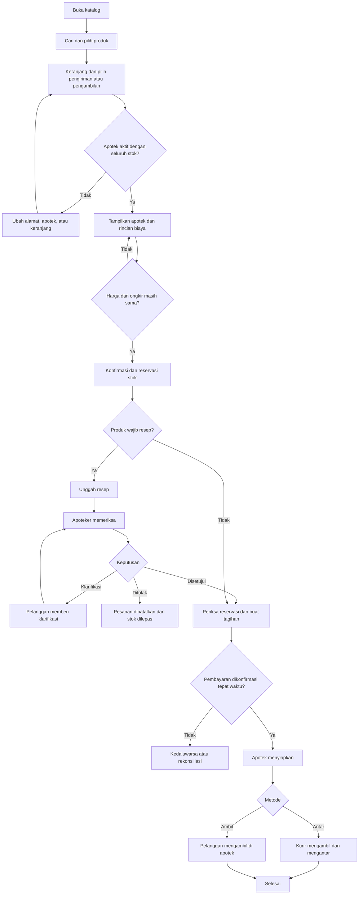

# App Flow Document — Apotek Digital MVP

**Versi:** 0.4 · **Status:** draf ditinjau  
**Terkait:** [PRD](01-PRD.md) · [Business Spec](07-BSD-Business-Spec.md)

## 1. Alur pelanggan

Jika reservasi 30 menit habis sebelum pembayaran terkonfirmasi, pesanan berakhir. Pelanggan membuat pesanan baru dan melihat kembali stok, harga, serta ongkir. Jika harga atau ongkir berubah saat konfirmasi, pelanggan harus menyetujui rincian baru sebelum pesanan dibuat. Setelah pesanan terbayar, reservasi tetap dijaga sampai pemenuhan atau pembatalan sah. Konfirmasi pembayaran yang diterima setelah pesanan kedaluwarsa, termasuk jika pelanggan membayar tepat waktu, masuk rekonsiliasi dan tidak mengaktifkan ulang pesanan.

## 2. Alur layar pelanggan

| Langkah | Layar | Aksi dan informasi penting |
|---|---|---|
| 1 | Beranda/katalog | Cari, pilih kategori, dan lihat indikasi resep. |
| 2 | Detail produk | Lihat informasi produk, harga indikatif, dan tambahkan jumlah. |
| 3 | Keranjang | Ubah jumlah, hapus item, pilih metode; masukkan alamat untuk pengiriman atau pilih apotek untuk pengambilan. |
| 4 | Konfirmasi | Pilih pengiriman/ambil, tinjau apotek dan rincian biaya, buat pesanan. |
| 5 | Resep bila perlu | Unggah dokumen, lihat status, jawab permintaan klarifikasi. |
| 6 | Pembayaran | Lihat metode, nominal, dan batas waktu tagihan. |
| 7 | Detail pesanan | Lihat status resep, pembayaran, penyiapan, pengiriman, dan bantuan. |
| 8 | Riwayat | Buka pesanan terdahulu dan status refund jika ada. |

Login/registrasi muncul sebelum pesanan dibuat; pengguna dapat menjelajah katalog tanpa login. Validasi alamat pengiriman jika diperlukan dan pemilihan apotek dilakukan sebelum konfirmasi. Untuk pesanan wajib resep, jam layanan pemeriksaan dan batas reservasi ditampilkan; pesanan tidak dapat dibuat di luar jam pemeriksaan resep apotek.

## 3. Alur apotek

1. Staf masuk dan memilih apotek sesuai penugasan.
2. Apoteker membuka antrean resep, melihat dokumen hanya untuk pesanan yang berwenang, lalu mencatat keputusan dan alasan bila diperlukan.
3. Setelah pembayaran dikonfirmasi, staf melihat pesanan siap diproses, memeriksa fisik produk dan stok, lalu menyiapkan sesuai SOP farmasi.
4. Petugas mencatat pemeriksaan kesesuaian produk, satuan jual, jumlah, kondisi, lot/batch bila relevan, dan kedaluwarsa. Pesanan resep memerlukan konfirmasi akhir apoteker sebelum `ready`.
5. Staf mencatat penyerahan kepada kurir atau pelanggan dengan waktu dan bukti serah terima. Pesanan pengiriman selesai berdasarkan bukti penerimaan; pickup selesai ketika diambil dengan bukti sesuai SOP.
6. Apabila produk tidak tersedia atau ada kendala, staf menghentikan pemenuhan dan mengeskalasi kepada CS.

## 4. Alur admin/CS

1. Admin mengaktifkan apotek setelah pemeriksaan operasional dan legal; mengelola katalog dan penandaan produk wajib resep berdasarkan keputusan farmasi. Keputusan resep pelanggan hanya oleh apoteker berwenang.
2. CS mencari pesanan menggunakan ID dan melihat data minimum yang diperlukan.
3. CS mencatat alasan kendala atau pembatalan; petugas berwenang memutuskan refund sesuai kebijakan.
4. Sistem mengirim permintaan refund, menampilkan hasil, dan mencatat jejak audit.

## 5. Status dan kondisi khusus

| Area | Status yang ditampilkan | Penanganan |
|---|---|---|
| Resep | Menunggu unggah, menunggu tinjauan, klarifikasi, disetujui, ditolak | Keputusan hanya oleh apoteker. |
| Pembayaran | Belum ditagih, menunggu, berhasil, gagal, kedaluwarsa, perlu rekonsiliasi | Pembayaran yang diterima setelah pesanan berakhir ditinjau dan direfund sesuai penyelesaian. |
| Pesanan | Menunggu resep, menunggu bayar, terbayar, diproses, siap, dikirim, selesai, dibatalkan, kedaluwarsa | Transisi dikendalikan backend. |
| Refund | Diajukan, diproses, berhasil, gagal | Status gagal masuk antrean CS. |

Pembatalan setelah terbayar memerlukan evaluasi; jika disetujui, refund diproses ke metode yang tersedia menurut penyedia dan kebijakan bisnis. Sistem tidak menjanjikan semua produk dapat dikembalikan.

## 6. Pembatalan, kendala dan status terminal

| Kondisi fisik | Jalur yang diizinkan |
|---|---|
| Belum diserahkan, status sebelum atau sesudah pembayaran sampai `ready` | Ajukan pembatalan; backend memeriksa status terkini. Sebelum dibayar, pembatalan sah dapat langsung diproses; setelah dibayar, diperlukan keputusan petugas berwenang. |
| Kurir sudah menerima, status `in_delivery` | Tidak dapat dibatalkan melalui transisi biasa. Buka kasus bantuan untuk pengiriman, pengembalian atau dana. |
| Pelanggan sudah menerima atau mengambil, status `completed` | Status tetap selesai; keluhan dan refund dicatat terpisah. |
| Status `cancelled` atau `expired` | Tidak diaktifkan ulang; pembayaran susulan masuk rekonsiliasi. |

Jika kurir gagal mengantar, pesanan tetap `in_delivery` dengan kasus bantuan dan status pengiriman `exception`; sistem tidak menyatakan selesai atau mengembalikan stok otomatis. Pembatalan dan serah terima yang terjadi bersamaan harus menghasilkan tepat satu keputusan yang valid berdasarkan status terkunci.

Kegagalan mengirim email/SMS tidak mengubah hasil pembayaran atau pemenuhan; pelanggan tetap dapat melihat status di aplikasi. Upload atau review resep setelah tagihan dibuat ditolak dan diarahkan ke bantuan untuk mencegah perubahan persetujuan selama proses pembayaran.
