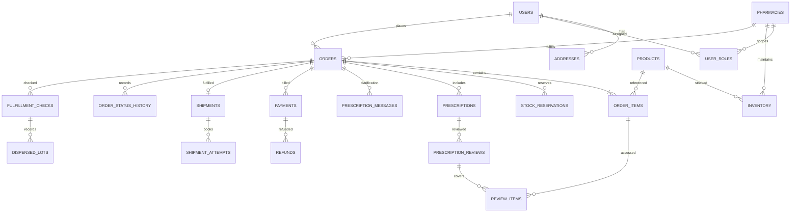

# Database Design Document — FarmaGO MVP

**Versi:** 0.4 · **DBMS:** PostgreSQL · **Status:** rancangan konseptual dan logis ditinjau  
**Terkait:** [TRD](02-TRD.md) · [Backend Schema](06-BSD-Backend-Schema.md)

## 1. Prinsip

Database adalah sumber kebenaran untuk transaksi. ID menggunakan UUID; waktu menggunakan `timestamptz` dalam UTC; nilai uang menggunakan `numeric(14,2)` dalam rupiah. Data asli resep disimpan sebagai objek privat; database menyimpan kunci objek, bukan URL publik. Dokumen ini adalah rancangan untuk diturunkan menjadi migration, bukan SQL siap produksi.

## 2. ERD

## 3. Kamus tabel

Kolom `id` adalah primary key kecuali tabel yang disebut memiliki kunci gabungan. Kolom wajib kecuali disebut opsional; FK berarti foreign key.

### Identitas dan apotek

| Tabel | Kolom utama | Kendala |
|---|---|---|
| `users` | `id`, `name`, `email?`, `phone?`, `password_hash`, `email_verified_at?`, `phone_verified_at?`, `status`, `created_at`, `updated_at` | Email/telepon unik bila terisi; setidaknya satu kontak; status aktif/nonaktif. Kontak untuk transaksi harus terverifikasi; mengganti kontak mereset verifikasinya. |
| `auth_sessions` | `id`, `user_id` FK, `session_token_hash`, `expires_at`, `revoked_at?`, `created_at` | Simpan hash token, bukan token mentah; sesi dapat dicabut. Kebutuhan MFA staf termasuk penyimpanan rahasia terenkripsi dan kode pemulihan yang di-hash. |
| `auth_tokens` | `id`, `user_id` FK, `type`, `target_contact?`, `token_hash`, `expires_at`, `used_at?`, `created_at` | Token verifikasi terikat pada nilai kontak yang dituju; reset terikat pada pengguna. Berumur pendek dan sekali pakai; token tidak disimpan mentah. |
| `user_roles` | `id`, `user_id` FK, `role`, `pharmacy_id?` FK, `created_at` | Peran `customer`, `pharmacist`, `pharmacy_staff`, `admin`, `cs`, `finance`; staf apotek wajib memiliki `pharmacy_id`. Kombinasi penugasan unik. |
| `addresses` | `id`, `user_id` FK, `recipient_name`, `phone`, `address_text`, `latitude?`, `longitude?`, `created_at` | Pemilik dapat memiliki banyak alamat; koordinat hanya bila diperlukan. |
| `pharmacies` | `id`, `name`, `address_text`, `latitude`, `longitude`, `status`, `license_reference?`, `created_at` | Status `pending`, `active`, `suspended`; cakupan disetujui saat onboarding. |
| `pharmacy_service_hours` | `id`, `pharmacy_id` FK, `service_type`, `weekday`, `opens_at`, `closes_at`, `timezone`, `active` | Jam mingguan menurut zona waktu IANA, termasuk layanan resep; pengecualian hari libur/tutup mendadak disimpan pada `pharmacy_service_exceptions` dan didahulukan. Jam lintas hari dipecah per hari. |
| `pharmacy_service_exceptions` | `id`, `pharmacy_id` FK, `service_type`, `local_date`, `closed`, `opens_at?`, `closes_at?`, `reason?` | Satu pengecualian per apotek, layanan, dan tanggal; jika `closed`, jam buka/tutup kosong. |

### Katalog dan stok

| Tabel | Kolom utama | Kendala |
|---|---|---|
| `products` | `id`, `sku`, `name`, `description`, `category`, `sell_unit`, `batch_tracking_required`, `requires_prescription`, `special_handling`, `status`, `created_at` | `sku` unik; satu SKU satu satuan jual utuh; status `active`/`inactive`; produk penanganan khusus default tidak aktif sampai kapabilitas disetujui. |
| `inventory` | `pharmacy_id` FK, `product_id` FK, `on_hand`, `reserved`, `unit_price`, `sales_blocked`, `updated_at` | PK gabungan `(pharmacy_id, product_id)`; `on_hand` adalah alokasi daring; `on_hand >= reserved >= 0`; kuantitas bilangan bulat per satuan jual; harga ≥ 0. `sales_blocked` menghentikan penjualan ketika ada selisih stok yang belum diselesaikan. |
| `stock_reservations` | `id`, `order_id` FK, `order_item_id` FK, `pharmacy_id` FK, `product_id` FK, `quantity`, `status`, `expires_at`, `created_at` | Kuantitas > 0; status `active`, `consumed`, `released`, `expired`; `order_item_id` unik. Pesanan, apotek, produk, dan jumlah harus sesuai item terkait. |
| `inventory_movements` | `id`, `pharmacy_id` FK, `product_id` FK, `order_id?` FK, `delta_on_hand`, `reason`, `actor_id?` FK, `created_at` | Jejak penambahan, koreksi, atau pengurangan stok fisik; koreksi tidak melanggar reservasi. |

### Transaksi

| Tabel | Kolom utama | Kendala |
|---|---|---|
| `checkout_quotes` | `id`, `customer_id` FK, `pharmacy_id` FK, `address_id?` FK, `address_snapshot?` JSONB, `fulfillment_method`, `delivery_option_id?`, `items_snapshot` JSONB, `totals_snapshot` JSONB, `expires_at`, `created_at` | Quote sementara, milik pelanggan, tanpa menjamin stok; alamat dan opsi kurir wajib untuk `delivery`, kosong untuk `pickup`. Perubahan isi alamat/metode/item atau harga memerlukan quote baru, meskipun ongkir kebetulan sama. |
| `orders` | `id`, `quote_id` FK, `customer_id` FK, `pharmacy_id` FK, `address_snapshot?` JSONB, `fulfillment_method`, `status`, `document_revision`, `review_version`, `subtotal`, `discount`, `shipping_fee`, `service_fee`, `total`, `expires_at`, `created_at`, `updated_at` | `quote_id` unik; snapshot alamat wajib untuk `delivery`, kosong untuk `pickup`; ongkir pickup nol. Nilai nonnegatif; `total = subtotal - discount + shipping_fee + service_fee`. `document_revision` dan `review_version` menjaga keputusan resep dari perubahan dokumen dan peninjauan bersamaan. |
| `order_items` | `id`, `order_id` FK, `product_id` FK, `product_name_snapshot`, `requires_prescription_snapshot`, `quantity`, `unit_price`, `line_total` | Kuantitas > 0; `line_total = quantity × unit_price`; `(order_id, product_id)` unik. |
| `prescriptions` | `id`, `order_id` FK, `uploaded_by` FK, `object_key`, `document_sha256`, `source_reference?`, `status`, `created_at` | Status `pending`, `clarification`, `approved`, `rejected`; hash untuk sinyal duplikasi, bukan bukti keaslian. Banyak dokumen dapat melekat pada pesanan. |
| `prescription_reviews` | `id`, `prescription_id` FK, `pharmacist_id` FK, `document_revision`, `review_sequence`, `decision`, `reason?`, `created_at` | Append-only; urutan keputusan diberikan server di bawah lock pesanan. Hanya keputusan untuk revisi dokumen terkini yang berlaku. Akses catatan klinis dibatasi. |
| `review_items` | `review_id` FK, `order_item_id` FK | PK gabungan; mencatat item yang dicakup keputusan. Item dan resep harus berasal dari pesanan yang sama; setiap item wajib resep membutuhkan keputusan persetujuan yang masih berlaku. |
| `prescription_messages` | `id`, `order_id` FK, `author_id` FK, `message_type`, `body?`, `private_object_key?`, `created_at` | Klarifikasi dan jawaban hanya terlihat oleh pelanggan pemilik dan apoteker yang ditugaskan; setidaknya isi atau lampiran wajib ada. Isi tidak masuk log umum. |
| `payments` | `id`, `order_id` FK, `provider`, `merchant_reference`, `provider_reference?`, `amount`, `received_amount?`, `currency`, `status`, `expires_at`, `provider_paid_at?`, `confirmed_at?`, `created_at` | Status `creating`, `pending`, `succeeded`, `failed`, `expired`, `late`; nominal tagihan dan dana aktual terpisah; IDR. Referensi merchant unik dan `(provider, provider_reference)` unik bila terisi. Satu tagihan `creating`/`pending` per pesanan; `succeeded` hanya satu per pesanan. Dana tambahan/selisih ditangani sebagai `late` untuk rekonsiliasi. |
| `refunds` | `id`, `payment_id` FK, `merchant_reference`, `amount`, `reason`, `status`, `provider_reference?`, `requested_by` FK, `created_at` | Referensi merchant unik. Status `requested`, `processing`, `succeeded`, `failed`; hasil tidak pasti tetap `processing`. Jumlah refund diminta, diproses, dan berhasil tidak melebihi dana diterima; hanya gagal definitif melepas kuota. |
| `fulfillment_checks` | `id`, `order_id` FK, `checked_by` FK, `result`, `products_match`, `quantities_match`, `condition_ok`, `expiry_ok`, `created_at` | Pemeriksaan sebelum `ready`; seluruh pemeriksaan wajib lulus. Pemeriksa akhir pesanan resep wajib apoteker di apotek terkait. |
| `dispensed_lots` | `id`, `check_id` FK, `order_item_id` FK, `lot_number`, `expiry_date`, `quantity` | Dicatat untuk produk `batch_tracking_required`; jumlah lot per item sama dengan jumlah yang dipenuhi. Ini catatan lot yang dipilih petugas, bukan perhitungan otomatis stok per lot. |
| `shipments` | `id`, `order_id` FK, `method`, `status`, `handed_over_at?`, `handover_actor_id?` FK, `handover_evidence_key?`, `delivered_at?`, `delivery_evidence_key?`, `created_at` | Satu pemenuhan logis per pesanan; metode `delivery`/`pickup`; status `pending`, `booking`, `booked`, `in_transit`, `delivered`, `exception`, `picked_up`. Bukti privat dan akses terbatas; pickup tidak menggunakan kurir. |
| `shipment_attempts` | `id`, `shipment_id` FK, `merchant_reference`, `provider`, `provider_reference?`, `tracking_number?`, `status`, `created_at` | Referensi merchant unik; status `creating`, `booked`, `failed`, `cancelled`; hasil tidak pasti tetap `creating`. Satu percobaan aktif per pemenuhan; booking baru setelah kegagalan/pembatalan sebelumnya pasti. |
| `cancellation_requests` | `id`, `order_id` FK, `requested_by` FK, `reason`, `status`, `decision_by?` FK, `decision_reason?`, `created_at`, `decided_at?` | Status `requested`, `approved`, `rejected`; hanya petugas berwenang memutuskan pembatalan setelah pembayaran. |
| `support_cases` | `id`, `order_id` FK, `opened_by` FK, `type`, `status`, `summary`, `assigned_to?` FK, `created_at`, `closed_at?` | Menyimpan kendala operasional, termasuk pembayaran yang perlu rekonsiliasi dan pengiriman gagal; ringkasan tidak memuat isi resep. |

### Operasional dan audit

| Tabel | Kolom utama | Kendala |
|---|---|---|
| `order_status_history` | `id`, `order_id` FK, `from_status?`, `to_status`, `actor_id?` FK, `created_at` | Append-only; actor kosong untuk sistem. |
| `audit_logs` | `id`, `actor_id?` FK, `action`, `entity_type`, `entity_id`, `metadata`, `created_at` | Tidak memuat isi resep, token atau rahasia; akses dibatasi. |
| `provider_events` | `id`, `provider`, `event_id`, `event_type`, `processed_at?`, `status`, `created_at` | `(provider, event_id)` unik untuk idempotensi webhook. |
| `outbox` | `id`, `event_type`, `aggregate_id`, `payload`, `status`, `attempts`, `next_attempt_at`, `created_at` | Event ditulis bersama transaksi bisnis; payload minimal dan retry aman. |
| `idempotency_keys` | `id`, `actor_id` FK, `key`, `operation`, `request_hash`, `response_reference?`, `created_at` | `(actor_id, operation, key)` unik; request berbeda dengan key sama ditolak. |

## 4. Akses, indeks, dan siklus hidup

- Indeks: `orders(customer_id, created_at)`, `orders(pharmacy_id, status, created_at)`, `prescriptions(status, created_at)`, `stock_reservations(status, expires_at)`, `payments(provider, provider_reference)` dan indeks pencarian produk sesuai hasil pengukuran.
- Jangan membuat cascade delete yang menghapus transaksi atau audit tanpa aturan retensi. Gunakan penonaktifan untuk master data yang sudah direferensikan.
- Akses ke data dibatasi pada layer aplikasi dan akun database dengan hak minimum. Enkripsi dan backup mengikuti TRD; durasi retensi disahkan oleh legal/farmasi.
- Saat pemesanan, lock baris `inventory` dalam urutan produk konsisten, periksa `on_hand - reserved`, lalu buat pesanan, item, dan reservasi dalam satu transaksi. Release/consume mengubah status reservasi dan angka stok dalam transaksi yang sama.
- Satu quote hanya dapat dipakai untuk satu pesanan; cek keunikan ini dan `Idempotency-Key` pada server, bukan di frontend. Pertahankan hanya satu tagihan berstatus `creating`/`pending` menggunakan constraint/indeks unik parsial.
- Job kedaluwarsa dan konfirmasi pembayaran mengunci pesanan yang sama. Job hanya melepas reservasi pesanan yang belum terbayar; reservasi pesanan `paid` tetap aktif sampai konsumsi atau pembatalan sah. Peristiwa masuk setelah `expired`/`cancelled` dicatat sebagai `late` untuk rekonsiliasi.
- Pelanggan menyetujui quote yang valid; perubahan komponen harga memerlukan quote baru. Saat pembatalan setelah stok dikonsumsi, pengembalian stok fisik hanya melalui pergerakan stok setelah pemeriksaan apotek.
- Gunakan constraint dan transaksi untuk invariant; logika otorisasi tidak hanya bergantung pada constraint database.

## 5. Invariant lintas tabel

1. `order_items`, `stock_reservations`, hasil pemeriksaan dan catatan lot harus berasal dari pesanan/apotek yang sama; gunakan FK gabungan bila memungkinkan dan transaksi/validasi server untuk invariant sisanya.
2. `orders.subtotal` sama dengan jumlah `order_items.line_total`. Pembayaran untuk pemenuhan sama dengan total pesanan, mata uang IDR, dan tidak boleh menggandakan pemenuhan. Dana berbeda nominal masuk kasus rekonsiliasi.
3. Dokumen baru menaikkan `document_revision`, membatalkan efektivitas persetujuan versi sebelumnya, dan menaikkan `review_version`. Review mencantumkan `expectedReviewVersion`; konflik ditolak. Setelah tagihan dibuat, upload/review baru tidak diizinkan melalui endpoint biasa.
4. Keputusan resep hanya efektif untuk seluruh jumlah item yang dipesan; MVP tidak mendukung dispensasi parsial. Riwayat pemeriksaan dan catatan lot dapat ditelusuri melalui pesanan sampai serah terima. Penggunaan ulang resep harus ditelaah apoteker; kesamaan/ketidaksamaan hash saja tidak memutuskan validitas.
5. Pembatalan dan serah terima dikunci pada pesanan yang sama. `in_delivery`/`completed` tidak dapat menjadi `cancelled`; refund dan kasus bantuan dapat berlangsung tanpa mengubah status fisik.
6. Constraint pembayaran/refund melindungi referensi unik dan kuota; event usang tidak menurunkan status dana yang sudah diterima. Hasil penyedia yang belum pasti tidak boleh melepaskan kuota refund.
7. Penetapan peran internal tidak tersedia melalui registrasi publik. Peran pusat menggunakan `pharmacy_id = NULL`; penugasan unik harus memperhitungkan NULL melalui indeks parsial terpisah agar duplikat peran pusat tidak lolos.
